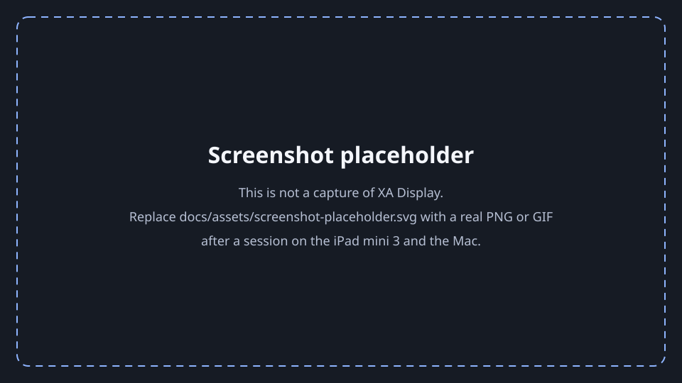
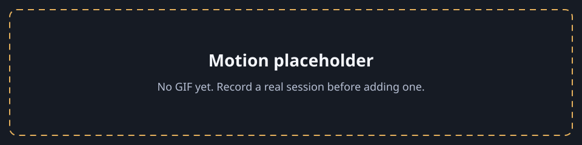
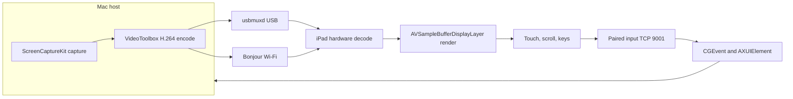

# XA Display

[](https://github.com/bunnydhanush21/XA-Display/actions/workflows/ci.yml)
[](LICENSE)
[](docs/ARCHITECTURE.md)
[](docs/ARCHITECTURE.md)
[](Package.swift)

<p align="center">
  
</p>

**XA Display** is an extended display and pointer for an Apple silicon Mac and a jailbroken iPad mini 3. The Mac creates the display, encodes H.264, and injects paired mouse and keyboard events. The iPad decodes the picture and sends touch, scroll, and keys back.

Pointer injection is CGEvent mouse and keyboard input, plus Accessibility window and menu actions. It is not native macOS touchscreen input.

<p align="center">
  
</p>

<p align="center">
  
</p>

## Feature grid

| Area | What ships | Where |
|---|---|---|
| Picture | H.264 Main, no B-frames, hardware decode | Mac encode, iPad `AVSampleBufferDisplayLayer` |
| Presets | Balanced, Safe, experimental Native | Host menu. See the targets table below |
| Transport | USB first through Apple usbmuxd, Wi-Fi fallback | TCP 9000 video, TCP 9001 input |
| Pairing | Token required unless both sides turn it off | Input hello. Video touch JSON is ignored |
| Pointer | Tap, double-tap, drag, two-finger scroll, trackpad mode | CGEvent on the virtual display |
| Keys | Sidebar modifiers, software keyboard, hardware shortcuts | CGEvent key and flags |
| Windows | Snap, fill, title-bar flick, corner resize, recovery | Public AXUIElement |
| Touch-style gestures | Loupe, traffic lights, menu overlay, right-edge drawer | Settings. Still pointer and Accessibility |
| Audio | Off by default. AAC-LC or PCM, jitter buffer, volume | Second ScreenCaptureKit stream |
| Clipboard | Off by default. Text, 12 KB | Images are framed and not applied |
| Quality | Thermal, battery, and send-queue bitrate steps | iPad health reports |
| Metrics | Delivered FPS, handoff, capture→ack, input RTT | Named for what they measure |

Deferred: MIDI, multitouch app integrations, image clipboard apply, three-finger pinch and spread, per-app command strips, launch at login, and a jailbreak launchd helper. See [Roadmap](#roadmap).

## Architecture



The iPad listens. The Mac connects. Video is length-prefixed Annex-B on port 9000. Input is a versioned binary session on port 9001. Details are in [docs/ARCHITECTURE.md](docs/ARCHITECTURE.md) and [docs/PROTOCOL.md](docs/PROTOCOL.md).

## Protocol

Input protocol **version 1**. A frame is `version (u8) | type (u8) | flags (u16) | length (u32) | payload`, big-endian. Video frames are a 4-byte big-endian length and either a JSON control object or an H.264 Annex-B access unit. Declared lengths are rejected before the body is read. The full map of message types, caps, and the OpenDisplay compatibility boundary is [docs/PROTOCOL.md](docs/PROTOCOL.md).

## Performance presets

These are **engineering targets**, chosen so the stream fits published H.264 level limits on an A7 iPad. They are not measured glass-to-glass, FPS, or bitrate results. No benchmark numbers are claimed. The method for measuring them later is [docs/PERFORMANCE.md](docs/PERFORMANCE.md).

| Preset | Pixels | FPS target | Profile / level | Bitrate target | Status |
|---|---|---|---|---|---|
| Balanced (default) | 1440×1080 | 30 | Main 4.1, no B-frames | 8 Mb/s USB, 6 Mb/s Wi-Fi | Target. Fits Level 4.1 MaxFS |
| Safe | 1024×768 | 30 | Main 3.1, no B-frames | 4 Mb/s USB, 3 Mb/s Wi-Fi | Target. Fits Level 3.1 MaxFS |
| Native | 2048×1536 | 30 | Main 5.0, no B-frames | 18 Mb/s USB, 12 Mb/s Wi-Fi | Experimental target. Does not fit Level 4.2 |

Native steps down to Balanced, then Safe, if encode or decode fails. The host also lowers bitrate when the iPad reports heat, a low battery, or a backed-up send queue.

## Install

CI on `macos-15` with **Xcode 16.4** builds an unsigned `XADisplay.ipa` and `XADisplayHost.zip`. Xcode 26 cannot target iOS 12. A tag `v*` runs [Release](.github/workflows/release.yml) and attaches those files to a **draft** GitHub Release.

Jailbroken iPad (device is trusted, `ldid` is installed):

```bash
unzip XADisplay.ipa
ldid -S Payload/XADisplay.app
cp -R Payload/XADisplay.app /Applications/
uicache -p /Applications/XADisplay.app
```

Mac:

```bash
unzip XADisplayHost.zip
mv XADisplayHost.app /Applications/
xattr -dr com.apple.quarantine /Applications/XADisplayHost.app
codesign --force --deep --sign - /Applications/XADisplayHost.app
```

Open the iPad app so it listens on ports 9000 and 9001. Open **XA Display Host** from the menu bar. Copy the pairing token into iPad settings. Grant **Screen Recording** and **Accessibility**, then quit and reopen the host if capture stays denied.

USB connects when the iPad is trusted and the cable carries data. With the cable unplugged, the host uses Wi-Fi only if that switch is on and both devices share a network.

Build from source:

```bash
swift test
brew install xcodegen swiftlint
(cd ios && xcodegen generate && xcodebuild -scheme XADisplay -sdk iphoneos -configuration Release CODE_SIGNING_ALLOWED=NO build)
(cd macos && xcodegen generate && xcodebuild -scheme XADisplayHost -destination 'platform=macOS' CODE_SIGNING_ALLOWED=NO build)
swiftlint lint --strict
swift-format lint --strict --configuration .swift-format --recursive Sources Tests ios macos
```

## Permissions

| Permission | Why |
|---|---|
| Screen Recording | Capture only the XA virtual display |
| Accessibility | Post CGEvent pointer and keys, and move or press windows |
| Local Network | Bonjour `_opensidecar._tcp` when USB is unavailable |
| USB trust | Apple usbmuxd forwards ports 9000 and 9001 |

Diagnostics export redacts the pairing token. The threat model is [docs/SECURITY.md](docs/SECURITY.md).

## Roadmap

- MIDI and multitouch integrations with apps that expect real touch
- Apply clipboard images, with the existing size cap
- Three-finger pinch to copy and spread to paste
- Per-app command-strip profiles from the frontmost bundle id
- Launch the host at login
- Optional jailbreak `launchd` plist, kept out of the app and away from Substrate
- Measured latency and FPS filled into [docs/PERFORMANCE.md](docs/PERFORMANCE.md) from the method written there

## Known limits

No Apple Pencil, pressure, hover, or a second pointer. Pinch magnifies the iPad picture and does not synthesize a Mac magnify event. Mute-on-Mac is unavailable without a virtual audio device. Opus is not used. Clipboard apply is text only. Secure-input fields can ignore injected keys. Native Retina is experimental. Glass-to-glass latency is a camera measurement this repo does not invent. A jailbreak is required only to install the unsigned iPad app.

## Docs

| Doc | Contents |
|---|---|
| [docs/ARCHITECTURE.md](docs/ARCHITECTURE.md) | Processes, threads, and data paths |
| [docs/PROTOCOL.md](docs/PROTOCOL.md) | Versioned wire format |
| [docs/SECURITY.md](docs/SECURITY.md) | Pairing and threat model |
| [docs/TESTING.md](docs/TESTING.md) | Automated tests and the device checklist |
| [docs/PERFORMANCE.md](docs/PERFORMANCE.md) | How to measure, and what is still unmeasured |
| [docs/adr/](docs/adr/) | Design decisions |
| [CONTRIBUTING.md](CONTRIBUTING.md) | Build, style, commits |
| [CHANGELOG.md](CHANGELOG.md) | Keep a Changelog |

## Credits and licensing

MIT. Copyright 2026 [Bunny Dhanush](https://github.com/bunnydhanush21) and the upstream author credited below. See [LICENSE](LICENSE) and [NOTICE](NOTICE).

The iPad receiver is derived from the MIT iOS 12 client by cuongpham1: [ipad-iphone-second-monitor-ios12-free](https://github.com/cuongpham1/ipad-iphone-second-monitor-ios12-free) at commit `5ea40029a9ebf78dd83ba7651ea59cdec2ae4e54`.

**GPL boundary.** XA Display Host is original MIT code. It is not a fork of OpenDisplay (GPL-3.0). This tree does not vendor OpenDisplay, Deskreen, libusbmuxd, or other GPL or LGPL source. The port 9000 video contract follows behavior documented by the MIT client so an OpenDisplay 1.30.x sender can still drive basic video, touch, and scroll. That compatibility does not copy OpenDisplay source. `CGVirtualDisplay` is Apple private API, isolated in `XAVirtualDisplay.m`, with declarations written for this project.

Do not run XA Display Host and OpenDisplay as senders at the same time.
