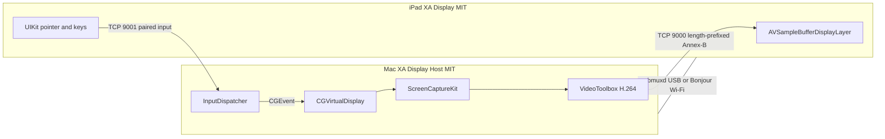

# XA Display

XA Display turns a jailbroken iPad mini 3 (iPad4,7, A7, 1 GB, iOS 12.5.8, 2048×1536) into an extended display for an Apple silicon Mac. The iPad app is a UIKit iOS 12 receiver. **XA Display Host** on the Mac creates the virtual display, encodes H.264, and injects pointer and keyboard events.

Pointer input is **CGEvent mouse and keyboard injection**. It is not native macOS touchscreen input, and it will not grow touch targets the way a touchscreen MacBook does.

## Features

Each item has a switch. Pairing, clipboard, and audio default as noted.

| Switch | Default | Where it applies |
|---|---|---|
| Require pairing | On | Mac enforces it. The iPad can also set the flag. Control is accepted only when the token matches, unless **both** sides turn pairing off. |
| Clipboard sync | Off | Plain text, 12 KB cap, both sides must enable it. |
| Three-finger shortcuts | On | Swipe left undo, right redo, up copy, down paste. |
| Pinch magnifier | On | Local zoom of the picture. Touches stay mapped through the zoom. Not a Mac pinch gesture. |
| Command strip | On | Esc, undo, redo, copy, paste, snap left/right, fill. |
| Window snapping | On | Moves windows with Accessibility. Also returns them to the main display when the virtual display closes. |
| Audio to iPad | Off | Separate ScreenCaptureKit audio stream. Modes: all system audio, selected apps, or apps whose windows are on the virtual display. AAC-LC when the encoder accepts it, otherwise PCM. iPad jitter buffer and volume slider. |
| Saved presets | On | Host remembers Balanced / Safe / Native. |
| Sidebar side and gesture timing | Left, medium | iPad settings. |
| Auto-connect on USB | On | Host menu. |
| Touchscreen-style gestures | On | Title-bar double-tap fill, flick to tile, edge drawer, precision crosshair, momentum scroll. |
| Wi-Fi fallback | On | Used only when USB is gone. |

Core path, always available: H.264 video, direct pointer, two-finger scroll, keyboard, sidebar modifiers, USB-first reconnect.

## Architecture



Port 9000 stays compatible with the OpenDisplay-style video contract (length prefix, JSON control, Annex-B). Port 9001 is XA's versioned input protocol. The host ignores touch JSON on port 9000 so an unpaired peer cannot inject input that way. OpenDisplay 1.30.x can still be the sender for basic video, touch, and scroll; keyboard, pairing, clipboard, audio, and window actions need XA Display Host. Do not run both senders at once.

Presets:

- **Balanced** (default): 1440×1080 @ 30, H.264 Main Level 4.1, no B-frames, 8 Mb/s USB or 6 Mb/s Wi-Fi.
- **Safe**: 1024×768 @ 30, Main Level 3.1, 4 Mb/s USB or 3 Mb/s Wi-Fi.
- **Native** (experimental): 2048×1536 @ 30, Main Level 5.0, about 18 Mb/s USB. This is outside Apple's published Level 4.2 playback envelope. If encode or decode fails, the host steps down to Balanced, then Safe.

The host lowers bitrate when the iPad reports heat, a low battery, or a backed-up send queue. Frames that would break the reference chain are dropped until the next keyframe. Queues are capped.

### Audio

Audio is off until both the iPad switch and the Mac **Audio to iPad** switch are on. The picture stream does not carry audio. A second ScreenCaptureKit stream uses `capturesAudio = true` and `excludesCurrentProcessAudio = true`.

- **All system audio** uses a display filter with an empty exclude list.
- **Selected apps only** uses `SCContentFilter(display:includingApplications:exceptingWindows:)` for the checked bundle ids.
- **Apps on the iPad display** rebuilds that include list from windows that intersect the virtual display.

Packets are AAC-LC (1024 samples, about 21 ms at 48 kHz) when AudioToolbox accepts the converter, otherwise little-endian PCM. Each packet carries the host capture time. The iPad estimates clock offset from input ping/pong and holds packets in a jitter queue (target 60 ms, drop if more than 140 ms late, at most 6 packets). Playback is AudioQueue on iOS 12. The settings slider scales PCM before it is queued.

**Mute on Mac while routed** is not implemented. Public Core Audio can mute the output device, which silences the speakers and usually the capture as well. There is no public per-app mute that keeps a process tap alive without a virtual audio driver. Opus is not used; it would need a third-party codec.

Metrics on the iPad:

- **FPS delivered** counts frames handed to the display layer.
- **Handoff** is receive-to-enqueue on the iPad clock. The hardware decode itself stays inside `AVSampleBufferDisplayLayer` and is not a separate callback.
- **Capture→ack** is host-clock time from capture until the iPad's echo comes back. It includes the return trip. It is not glass-to-glass.
- **Input RTT** is a ping on the input channel.

## Install

The GitHub Action on `macos-15` with **Xcode 16.4** builds an unsigned `XADisplay.ipa` and `XADisplayHost.zip`. Xcode 26 cannot target iOS 12.

On the jailbroken iPad:

```bash
unzip XADisplay.ipa
ldid -S Payload/XADisplay.app
cp -R Payload/XADisplay.app /Applications/
uicache -p /Applications/XADisplay.app
```

On the Mac, unzip the host, move `XADisplayHost.app` to `/Applications`, and if Gatekeeper complains:

```bash
xattr -dr com.apple.quarantine /Applications/XADisplayHost.app
codesign --force --deep --sign - /Applications/XADisplayHost.app
```

Open the iPad app. It listens on ports 9000 and 9001. Open the host from the menu bar. Copy the pairing token into the iPad settings. Grant **Screen Recording** and **Accessibility**, then quit and reopen the host if capture stays denied.

USB is automatic when the iPad is trusted and the cable carries data. Unplug the cable and the host falls back to Wi-Fi if that switch is on and both devices are on the same network.

## Permissions and troubleshooting

- No new display: Screen Recording was denied, or the virtual display SPI failed. Export diagnostics from the menu.
- Pointer does nothing: Accessibility is off, pairing was rejected, or the token does not match. A rejected iPad must not move the cursor.
- Black screen after switching apps: iOS suspended the listener. Returning to the app reconnects.
- Warm iPad: the overlay names the thermal state. The host should step the preset down. Do not disable thermal limits.
- Windows left off-screen: quit the host. It moves windows that intersected the virtual display back onto the main display. This needs Accessibility and is best-effort.

## Known limits

No Apple Pencil, pressure, hover, or true multi-pointer. Pinch does not synthesize a Mac magnify event. Audio is uncompressed PCM and optional. Clipboard is text only. Secure-input fields may ignore injected keys. Native Retina is experimental. Glass-to-glass latency is a camera measurement, not a number this app invents. A jailbreak is only required to install the unsigned iPad app; streaming itself uses public iOS decode and UIKit.

## Build locally

```bash
swift test
brew install xcodegen
(cd ios && xcodegen generate && xcodebuild -scheme XADisplay -sdk iphoneos -configuration Release CODE_SIGNING_ALLOWED=NO build)
(cd macos && xcodegen generate && xcodebuild -scheme XADisplayHost -destination 'platform=macOS' CODE_SIGNING_ALLOWED=NO build)
```

Use Xcode 16.x. See `TESTING.md` for the manual checklist.

## License

MIT. See `LICENSE` and `NOTICE`. The Mac host is not GPL.
