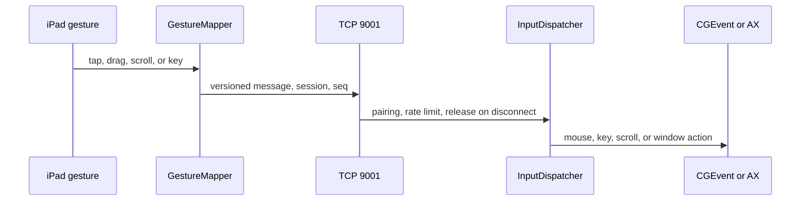

# Architecture

XA Display is three pieces:

| Piece | Path | Role |
|---|---|---|
| Protocol library | `Sources/XADisplayProtocol` | Framing, messages, geometry, presets, gesture rules. Foundation only, so `swift test` runs on Linux |
| iPad app | `ios/XADisplay` | UIKit, iOS 12, arm64. Listens, decodes, sends input |
| Mac host | `macos/XADisplayHost` | Menu-bar app, macOS 14+. Virtual display, encode, inject |

The iPad app is derived from the MIT client named in [NOTICE](../NOTICE). The host is original code. Design records are in [adr/](adr/).

## Picture path

```mermaid
sequenceDiagram
  participant Display as CGVirtualDisplay
  participant Capture as ScreenCaptureKit
  participant Encode as VideoToolbox
  participant Link as USB or Wi-Fi
  participant Decode as AVSampleBufferDisplayLayer
  Display->>Capture: framebuffer
  Capture->>Encode: pixel buffer
  Encode->>Link: Annex-B plus timing JSON
  Link->>Decode: length-prefixed frame
  Decode->>Decode: hardware decode and present
```

1. The host creates one virtual display on the main thread (`XAVirtualDisplay.m`). Vendor `0x5841`, product `0x0001`. HiDPI when the preset scale is at least 1.5. Native uses scale 2. Balanced and Safe are 1x.
2. `CapturePipeline` starts a `SCStream` for that display with `capturesAudio = false`.
3. `H264Encoder` uses Main profile, frame reordering off, a realtime hint, and a hardware encoder when VideoToolbox allows it. Keyframes are about once a second. Each IDR carries SPS and PPS. A JSON timing prefix records capture and encode times.
4. `InFlightGate` and `SendBudget` force an IDR after a drop so the iPad is not left on a broken reference chain. At most three frames are in flight.
5. The iPad `FrameParser` accepts the length prefix. `FrameAdmission` drops stale P-frames until the next keyframe. Decode is the display layer, not a second VideoToolbox session.

## Transport

The iPad binds `NWListener` on port 9000 (video) and port 9001 (input), with `TCP_NODELAY`. Bonjour type `_opensidecar._tcp`. iOS 12 advertises the service without a TXT record.

The host prefers USB. It speaks Apple's built-in usbmuxd plist protocol on `/var/run/usbmuxd` and connects with `Darwin.connect`. Wi-Fi is the fallback when the cable is gone and the switch is on. A loopback remote address means the socket arrived through usbmux, so the UI calls that USB.

## Input path



Direct Touch does not send mouse-down until the gesture is a tap, a drag past the slop, or a long-press. Trackpad mode moves a drawn cursor and is a separate path. Disconnect and cancel release buttons and modifiers.

Window fill, tile, resize, traffic lights, and menus use `AXUIElement` on the Mac. The host publishes window rectangles and menu titles as video-channel JSON (`xa.windows`, `xa.menus`, `xa.front`) so the iPad can draw 36-point targets. Those JSON messages are not CGEvents.

## Audio path

Audio is off until both switches are on. A second `SCStream` sets `capturesAudio = true` and `excludesCurrentProcessAudio = true`. Modes are all system audio, selected bundle ids, or apps whose windows intersect the virtual display. Samples are AAC-LC when the converter accepts them, otherwise little-endian PCM. Each packet has `hostTimeMs`. The iPad estimates clock offset from ping/pong and holds a jitter queue (target 60 ms, drop after 140 ms late, at most 6 packets).

## Adaptation and recovery

The iPad sends `health` (thermal state, battery, delivered FPS) and `frameAck`. The host steps bitrate down on heat, low battery, or a full send queue. Quitting the host moves windows that intersect the virtual display back onto the main display. That move is best-effort and needs Accessibility.

## What the overlay numbers mean

| Label | Clock | Includes |
|---|---|---|
| FPS delivered | iPad | Frames handed to the display layer |
| Handoff | iPad | Receive to enqueue. Not the hardware decode time |
| Capture→ack | Host, echoed | Capture until the ack returns. Includes the return trip |
| Input RTT | Both | Ping on port 9001 |

None of these is glass-to-glass. See [PERFORMANCE.md](PERFORMANCE.md).
